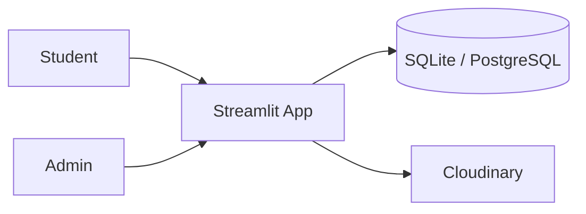
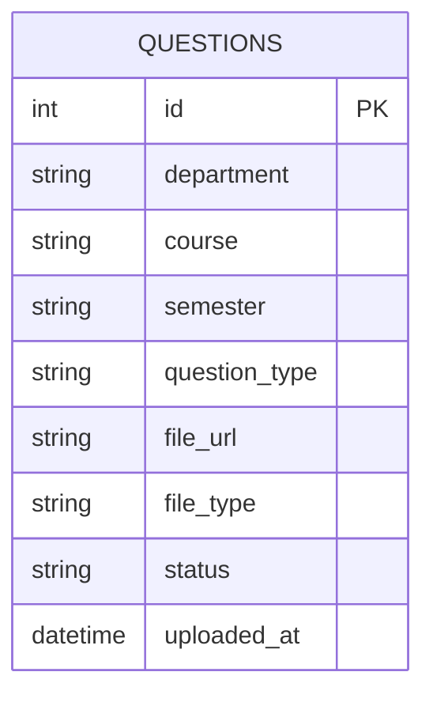

# SEU Question Bank 📚

A Streamlit web app where Southeast University students upload, browse, and search past exam question papers, with an admin approval step before anything goes public.

🔗 **Live demo:** https://seuquestionbank-5jp88dl7ukwxlgp7juw7v9.streamlit.app/

---

## Summary and Problem

Past question papers are one of the most useful ways to prepare for exams, but at SEU they are scattered across Facebook groups, Messenger chats, and personal phone galleries. They are hard to find, often incomplete, and easy to lose.

SEU Question Bank puts them in one place. Students can upload a paper as an image or PDF, and others can filter by department, course, semester, and exam type. Every upload goes to an admin first, so only reviewed papers appear publicly.

## Features

- **Browse and search:** filter by Department, Course, Semester, and Question Type (CT, Mid, Final, Others)
- **Upload papers:** supports JPG/PNG images and PDFs, stored on Cloudinary
- **Admin approval workflow:** new uploads start as Pending; an admin can approve or reject them
- **Dual database support:** SQLite for local development, PostgreSQL for production
- **Responsive UI:** built with Streamlit

## Architecture



- The Streamlit app handles both the UI and the backend logic.
- `db_manager.py` is the only layer that talks to the database.
- Uploaded files go to Cloudinary; the database stores the file URL and metadata.
- Only papers with status `Approved` are shown on the public browse page.

## Database (ERD)



`status` is `Pending`, `Approved`, or `Rejected`.

## Tech Stack

| Layer | Technology |
|---|---|
| Frontend | Streamlit |
| Backend | Python |
| Database | SQLite (local), PostgreSQL via `psycopg2` (production) |
| File storage | Cloudinary |
| Config | `python-dotenv` |
| Hosting | Streamlit Community Cloud |

## Project Structure

```
SEU_Question_Bank/
├── app.py               # Entry point and navigation
├── db_manager.py        # Database connection and CRUD (SQLite/PostgreSQL)
├── ui_helpers.py        # Shared rendering for image and PDF papers
├── pages/
│   ├── home.py          # Landing page
│   ├── 1_Question_Bank.py   # Browse and search
│   ├── 2_Upload.py          # Upload new papers
│   └── 3_Admin.py           # Admin dashboard
├── test_app.py          # Tests
├── requirements.txt
├── .env.example
└── .streamlit/
```

## Demo Credentials

| Role | Access |
|---|---|
| Student | No login needed. Browse and upload directly. |
| Admin | Password: `<demo-admin-password>` (set through `ADMIN_PASSWORD`) |

> Use a throwaway password for the demo. Never use your real one.

## Run and Tests

**1. Clone the repository**
```bash
git clone https://github.com/arrahmanriju/SEU_Question_Bank.git
cd SEU_Question_Bank
```

**2. Create a virtual environment**
```bash
python -m venv venv
source venv/bin/activate    # Windows: venv\Scripts\activate
```

**3. Install dependencies**
```bash
pip install -r requirements.txt
```

**4. Set environment variables**

Create a `.env` file (use `.env.example` as a template):

```env
# Optional. SQLite is used if this is not set
DATABASE_URL=your_postgresql_database_url

# Admin
ADMIN_PASSWORD=your_admin_password

# Cloudinary
CLOUDINARY_CLOUD_NAME=your_cloud_name
CLOUDINARY_API_KEY=your_api_key
CLOUDINARY_API_SECRET=your_api_secret
```

**5. Run the app**
```bash
streamlit run app.py
```
The app runs at `http://localhost:8501`.

**6. Run tests**
```bash
pytest test_app.py
```

## API Overview

This project has no REST API. Streamlit pages call Python functions directly.

| Component | Responsibility |
|---|---|
| `pages/1_Question_Bank.py` | Reads approved papers and applies filters |
| `pages/2_Upload.py` | Uploads the file to Cloudinary and saves the record as `Pending` |
| `pages/3_Admin.py` | Lists pending papers and updates their status (approve/reject) |
| `db_manager.py` | All database reads and writes |
| `ui_helpers.py` | Displays image and PDF papers |

## Deployment

- **App hosting:** Streamlit Community Cloud, deployed from the `main` branch
- **Database:** PostgreSQL in production through `DATABASE_URL`
- **Files:** Cloudinary
- **Secrets:** set `ADMIN_PASSWORD`, `DATABASE_URL`, and the Cloudinary keys in the Streamlit Cloud secrets settings, not in the repository

## Key Decisions

- **Streamlit for the whole app:** one Python codebase, fast to build and deploy, no separate frontend and backend.
- **SQLite locally, PostgreSQL in production:** setup stays simple for development, while production data survives restarts.
- **Cloudinary for files:** keeps images and PDFs out of the database and the repo.
- **Admin approval before publishing:** stops spam and wrong or low-quality uploads from appearing publicly.

## Known Limitations

- No individual user accounts; admin access uses a single shared password
- No duplicate paper detection, so the same paper can be uploaded twice
- Papers cannot be searched by their text content, only by metadata filters
- Streamlit's layout is less customizable than a full frontend framework

## Next Improvements

- User authentication and roles
- Search by exam year
- OCR text search inside papers
- Duplicate paper detection
- Mobile-friendly UI improvements
- Export papers as PDF

## Contributing

Contributions, issues, and feature requests are welcome. Check the [issues page](https://github.com/arrahmanriju/SEU_Question_Bank/issues).

## License

[MIT License](LICENSE)
